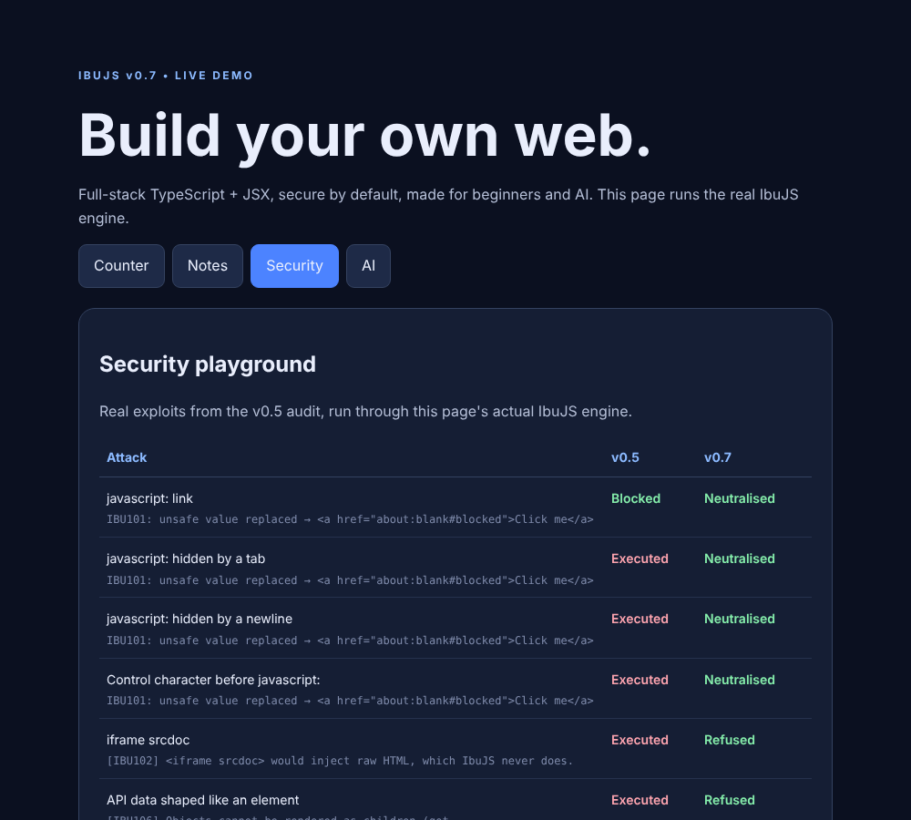

# IbuJS

**The full-stack TypeScript + JSX framework where the unsafe way doesn't exist.** Secure by default, built for AI assistants to write, and simple enough for your first app, with a 6 KB UI runtime.

**Live:** [ibujs.vercel.app](https://ibujs.vercel.app) (starter app on Vercel) · [ibujs.vercel.app/demo/](https://ibujs.vercel.app/demo/) (engine demo and security playground)

```tsx
// src/main.tsx (browser)
import { createApp, signal, resource, api } from '@ibujs/ui';

const notes = resource(() => api.get<{ id: number; text: string }[]>('/api/notes'));
const draft = signal('');

function App() {
  return (
    <main>
      <input bind={draft} placeholder="Write a note" />
      <button onClick={async () => { await api.post('/api/notes', { text: draft.value }); draft.value = ''; notes.refresh(); }}>Add</button>
      <ul>{(notes.data.value ?? []).map(n => <li key={n.id}>{n.text}</li>)}</ul>
    </main>
  );
}
createApp(App, '#app');
```

```ts
// src/server.ts (server)
import { createServer, s, serveStatic, publicDir, sqliteDatabase } from '@ibujs/server';

const app = createServer();                        // CSRF protection, security headers, CSP, timeouts: on
const db = await sqliteDatabase('data.db');        // built-in SQLite, nothing to install
await db.raw('CREATE TABLE IF NOT EXISTS notes (id INTEGER PRIMARY KEY AUTOINCREMENT, text TEXT NOT NULL)');

app.get('/api/notes', async ctx => ctx.json(await db.sql`SELECT * FROM notes ORDER BY id DESC`));
app.post('/api/notes', async ctx => {
  const { text } = await ctx.body(s.object({ text: s.string({ min: 1, max: 500 }) }));   // validated + typed
  ctx.json((await db.sql`INSERT INTO notes (text) VALUES (${text}) RETURNING *`)[0], 201); // injection-proof
});
app.use(serveStatic(publicDir(), { spa: true }));
app.listen(3000);
```

Typing `` as a note just shows that text. Nothing in IbuJS can render it as HTML.

## Quick start

Requires **Node.js 22.13+**.

```bash
npm install
npm run dev          # starter app at http://127.0.0.1:3000 (counter, SQLite notes, streaming AI chat)
npm run check        # typecheck + tests + security check + production build
npm run build && npm start
```

Create your own app:

```bash
node packages/cli/src/cli.mjs create my-app && cd my-app && npm install && npm run dev   # from this repo (framework copied in, works offline)
npx create-ibujs my-app                                                                     # once the packages are on npm
```

Every new app includes a `vercel.json`: push it to GitHub, import it on Vercel, add `SESSION_SECRET` (and `ANTHROPIC_API_KEY` for AI) as environment variables, and it deploys.

No install at all: open `demo/index.html` in a browser. It runs the real engine, including a **security playground** that fires the exploits from the v0.5 audit.



## Why IbuJS

| | |
|---|---|
| 🔒 **Secure by default** | No raw-HTML API exists. Elements are Symbol-branded, so API data can't become markup. URLs are checked with the browser's own parser. CSRF, CSP and security headers are on. SQL only through tagged templates. The build fails if browser code imports server secrets. |
| 🤖 **AI-native** | `llms.txt` + `AGENTS.md` steer Claude Code, Cursor, Copilot and Codex to correct code. `ibu ai "add a login page"` writes changes that are path-checked and security-linted, then typechecks them and has Claude fix its own mistakes before you see the result. `ibu review` does AI security reviews. `@ibujs/ai` adds streaming AI features with cost limits. |
| 🎓 **Beginner-first** | Every error has a code with a plain-English fix (`npx ibu explain IBU412`). Two-way `bind`, `resource()` for data, zero-config SQLite, a random secret generated for you, and `ibu doctor`. |
| ⚡ **Small, full-stack** | UI runtime 6.3 KB gzipped (React 19: 67.3 KB, measured). Only components whose signals changed re-render; server-rendered pages hydrate. One project for browser, server, database and AI. |

Full comparison with React, Next.js, Vue, Node + Express and vanilla JS: **[docs/USP.md](docs/USP.md)**.

## What's inside

| Package | Contents |
|---|---|
| `@ibujs/ui` | `signal`, `computed`, `effect`, `batch`, `resource`; JSX renderer with per-component updates, memoization, error isolation, keyed diffing, SVG, `bind`, refs; `hydrate`; `createRouter` + `Link`; `api()`; `renderToString` / `html```; dev error overlay |
| `@ibujs/server` | Router with middleware, `ctx.body(schema)`, `HttpError`; `s` validator; sessions, scrypt passwords, cookies; `definePolicy` authorization (deny by default); CSRF, CORS, rate limits, logger; `db.sql```, SQLite adapter; `serveStatic`; `renderPage` |
| `@ibujs/ai` | `createAI()`: `ask`, `stream`, `route()` for Claude, server-only, with rate, size, concurrency and disconnect guards |
| `@ibujs/cli` | `ibu create · dev · build · start · check · ai · review · explain · secret · doctor`; `ibu build --target=vercel` |
| `create-ibujs` | `npx create-ibujs my-app` |

## Commands

| Command | What it does |
|---|---|
| `npm run dev` | Dev server: client rebuilds and server restarts on save |
| `npm run build` / `npm start` | Production bundle in `dist/` / run it |
| `npm run check` | Typecheck, tests, security check, build |
| `npm run test:e2e` | 25 XSS payloads in real Chromium, plus a Node-vs-Chromium URL parsing differential fuzz (needs Playwright) |
| `npm run bench` | Rendering benchmark in Chromium (`-- --baseline=<git ref>` to compare) |
| `npm run release` | Build the npm packages into `.release/` (`-- --verify` installs and runs them in a fresh app) |
| `npm run demo` | Rebuild `demo/index.html` from the engine |
| `npx ibu check` | Offline security linter (16 checks) |
| `npx ibu ai "<task>"` | Claude edits your code, then typechecks, security-checks and fixes it (`--dry-run`, `--yes`, `--branch`, `--test`, `--fix-rounds=N`, `--effort=`) |
| `npx ibu review [files]` | AI security and bug review |
| `npx ibu explain <code>` | Explain any `IBUxxx` error (`--ai`, `--list`) |
| `npx ibu doctor` / `npx ibu secret` | Diagnose setup / generate a session secret |

AI commands need `ANTHROPIC_API_KEY` in `.env`. See [docs/AI.md](docs/AI.md).

## Security

IbuJS 0.6 was a rebuild after a full audit of v0.5. That audit reproduced a critical XSS (API data rendered as `<script>`), three high-severity XSS bypasses, and request-routing, CSRF, password-hashing, rate-limiting and supply-chain issues. All 19 findings are fixed and covered by tests. Details, evidence and **residual risks**: [docs/SECURITY-AUDIT.md](docs/SECURITY-AUDIT.md). Security model and reporting: [SECURITY.md](SECURITY.md).

v0.7 adds property-based fuzzing of the URL sanitizer, HTML renderer, cookie and session parsing, schemas, SQL builder and HTTP parsing, a Node-vs-Chromium URL differential test, a [threat model](docs/THREAT-MODEL.md), and a [scope document for an independent review](docs/SECURITY-REVIEW-SCOPE.md).

## Project layout

```
packages/ui        browser runtime          packages/cli/template   starter app (npm run dev, ibu create)
packages/server    HTTP server              tests/                  node:test suites + e2e/
packages/ai        AI helpers               demo/                   standalone demo + its source
packages/cli       ibu command, error catalog, linter   docs/       guides, audit, USP, roadmap
```

## Docs

[Beginner guide](docs/GUIDE.md) · [AI features](docs/AI.md) · [Why IbuJS / comparison](docs/USP.md) · [Security audit](docs/SECURITY-AUDIT.md) · [Threat model](docs/THREAT-MODEL.md) · [Releasing](docs/RELEASING.md) · [Roadmap](docs/ROADMAP.md) · [Changelog](CHANGELOG.md) · [API reference for AI (llms.txt)](llms.txt)

## Status

IbuJS 0.7 is a **well-tested prototype**, not yet production-proven. An independent security review is scoped but has not happened yet, the npm release pipeline (with provenance) is ready but nothing is published yet, and the ecosystem is new. See the [roadmap](docs/ROADMAP.md) for the path to 1.0.

MIT License.
